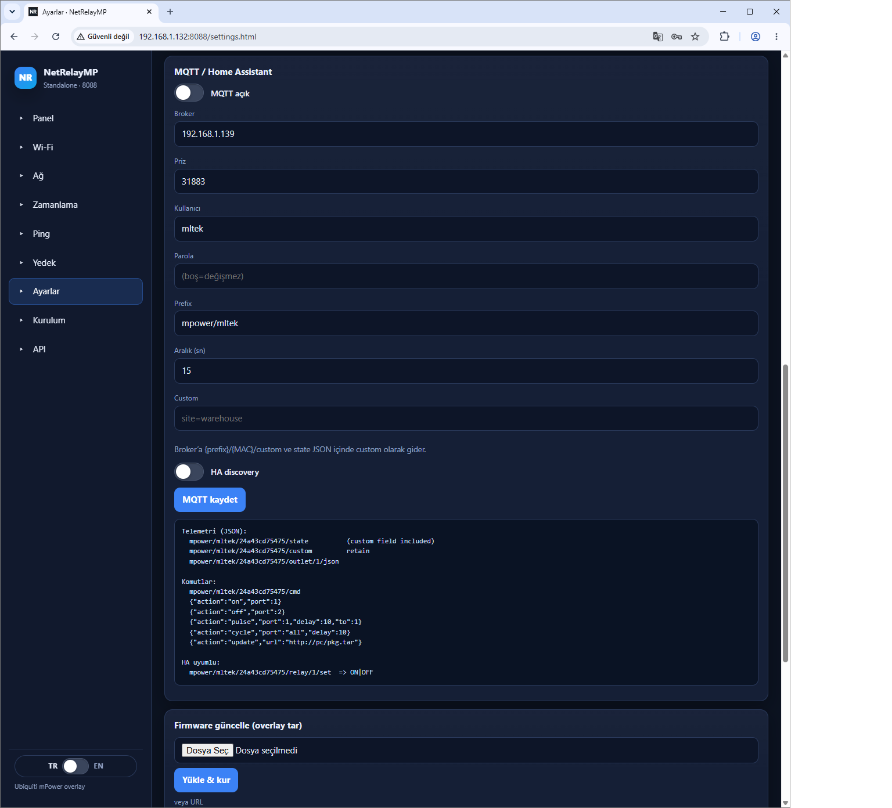

# NetRelayMP MQTT (TR)

Cihaz bir MQTT **istemcisidir**. Broker ayrı çalışır. Önerilen sunucu: [mqttserver](https://github.com/mlteknoloji/mqttserver) (port **31883**, panel **8082**). Depolar: [DEPOSLAR-TR.md](DEPOSLAR-TR.md).

Ekran görüntüleri: [OZELLIKLER-TR.md](OZELLIKLER-TR.md)

## Konfigürasyon



**Menü → MQTT** (`mqtt.html`): `enabled`, broker `host`/`port`, `user`/`pass`, `prefix` (varsayılan `mpower/mltek`), `interval`, `ha_discovery`.

- Başlıktaki ikon ve menüdeki nokta bağlantı durumunu gösterir: yeşil **Online**, kırmızı **Offline** (sebebiyle), sarı bağlanıyor.
- **MQTT log** kartı cihazdaki `/tmp/mpower-mqtt.log` dosyasını gösterir: bağlantı olayları ve hatalar (`ERR` kırmızı). **Canlı log** açıkken gönderilen/alınan mesajlar da 2 sn'de bir gelir.
- Röle değişiklikleri (panel, MQTT, zamanlama, ping, düğme) ~0,5 sn içinde `relay/N` olarak yayınlanır; `interval` yalnız ölçümler içindir.

Topic kökü: `{prefix}/{MAC}/` (varsayılan: `mpower/mltek/{MAC}/`; MAC küçük, `:` yok).

## Yayın (state)

Periyodik JSON: röle durumları, güç/enerji (cihaz destekliyorsa), **uptime (sn)**, çevrimiçi.

Ayrı topic: `{prefix}/{MAC}/uptime` → saniye (retain).

HA discovery açıksa Home Assistant otomatik entity oluşturur (uptime sensörü dahil).

## Komut

Topic: `{prefix}/{MAC}/cmd`

```json
{"action":"on","port":1}
{"action":"off","port":2}
{"action":"pulse","port":1,"seconds":5}
{"action":"cycle","port":1,"on":2,"off":2,"count":3}
{"action":"update","url":"http://192.168.1.10/netrelaymp-1.3.0.tar"}
```

## Saha doğrulama

```bash
mosquitto_sub -h BROKER -t 'mpower/mltek/#' -v
mosquitto_pub -h BROKER -t 'mpower/mltek/aabbccddeeff/cmd' -m '{"action":"off","port":1}'
```

Ayrıntılı checklist: [SAHA-TR.md](SAHA-TR.md)

Apple Home: [HOMEKIT-TR.md](HOMEKIT-TR.md)
